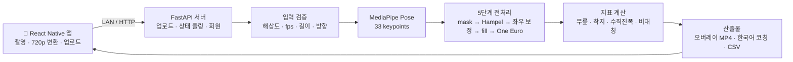

# TreadForm — 트레드밀 러닝 자세 분석 앱

> 스마트폰으로 트레드밀 측면 영상을 찍으면, **MediaPipe Pose**로 관절을 추적해 **부상 위험 3대 지표**를 계산하고 **한국어 코칭**과 스켈레톤 오버레이 영상을 돌려주는 모바일 앱 + 분석 서버


**기간** 2026.05

<!-- 데모 GIF 자리: 결과 화면(스켈레톤 오버레이 + 코칭 카드) 녹화본을 docs/images/demo.gif 로 넣으면 아래 줄 주석 해제

-->

---

## 핵심 성과

- **분석 엔진 전 과정 구현** — 포즈 추출 → 5단계 노이즈 제거 → 지표 계산 → 오버레이 렌더링 → 한국어 코칭 → CSV 리포트
- **분석 시간 30% 단축** — 포즈 추출 중복 호출 제거로 11초 영상 기준 165초 → 116초 ([BENCHMARK](docs/BENCHMARK.md))
- **판정 기준은 논문 근거로** — 무릎 굴곡·수직 진폭 등 임계값을 학술 문헌 13편으로 보정 ([REFERENCES](docs/REFERENCES.md))
- **테스트 221개** — 지표·전처리·렌더러·API·입력 영상 거부 E2E까지 pytest로 검증
- **PRD 9종으로 설계 문서화** — 포즈 추출부터 앱 화면까지 기능별 요구사항을 문서로 관리 ([docs/](docs/))

## 내 역할

- 서비스 기획 및 PRD 0~8 작성
- 분석 파이프라인(`server/analyzer/`) 설계·구현: 전처리 필터(Hampel, One Euro), 착지 검출, 3대 지표, 렌더러, 코칭 문구
- FastAPI 서버(업로드·분석 상태 조회·회원 관리)와 React Native 앱(촬영·업로드·결과·대시보드) 구현
- 지표 임계값 문헌 보정, 성능 측정 및 최적화

---

## 무엇을 분석하나

| 지표 | 보는 것 | 판정 |
|---|---|---|
| 무릎 굴곡 | 착지 순간 무릎 각도 | Stiff / Good / Over-bent |
| 착지 유형 · 오버스트라이딩 | 발이 몸통보다 앞에 떨어지는지 | Heel / Mid / Forefoot, Over / Good |
| 수직 진폭 | 한 걸음마다 몸이 위아래로 튀는 정도 (키 입력 시 cm 단위) | High / Good |
| 좌우 비대칭 | 왼발·오른발 지표 차이 | 10% 초과 시 경고 |

위험 구간은 자동으로 북마크되고, 결과 영상에서 0.5배속으로 다시 보여줍니다.

## 아키텍처



## 문제 해결 기록

**1. 같은 영상을 두 번 분석하고 있었다 → 30% 단축**
벤치마크를 돌려보니 11초 영상이 165초나 걸렸습니다. 결과 JSON용 분석과 렌더링용 분석이 각각 포즈 추출을 호출하고 있었고, 포즈 추출이 전체 비용의 절반이었습니다. 추출 결과(`raw_df`)를 한 번만 만들어 넘기도록 바꿔 116초로 줄였습니다.

**2. 빠른 페이스에서 관절을 놓친다 → 60fps 하한 + 신뢰도 등급**
30fps로 분당 200보를 찍으면 한 걸음에 9프레임뿐이라 다리가 흐려지고 좌우가 뒤바뀌었습니다. 입력 단계에서 60fps 미만을 거부하고, 분석 품질에 따라 `high / medium / low` 신뢰도와 경고를 함께 반환하도록 했습니다.

**3. 키가 큰 사람은 늘 "진폭 과다" → 키 기반 cm 보정**
수직 진폭 기준이 화면 비율(정규화 좌표)이라 체격·줌에 따라 결과가 흔들렸습니다. 사용자 키와 화면 속 몸길이로 cm 환산 배율을 구해 절대 기준(10cm, Cavanagh & Williams 1982)을 적용하고, 키가 없으면 기존 방식으로 동작하게 했습니다.

**4. 앱에서 영상 업로드만 실패 → 업로드만 XHR로 분리**
RN 0.85 + axios 1.16 조합에서 multipart 요청이 `ERR_NETWORK`로 떨어졌습니다. axios가 RN의 파일 객체를 인식하지 못해 Content-Type을 잘못 붙이는 문제였고, 업로드 요청만 `XMLHttpRequest`로 보내 해결했습니다.

더 많은 이슈는 [KNOWN_ISSUES](docs/KNOWN_ISSUES.md)에 정리했습니다.

---

## 기술 스택

| 영역 | 사용 기술 |
|---|---|
| 포즈 추정 | MediaPipe Pose Tasks API (Heavy 모델, 33 keypoints) |
| 신호 처리 | NumPy, pandas, SciPy — Hampel 필터, One Euro 필터 |
| 영상 | OpenCV (오버레이 렌더링, H.264 출력) |
| 서버 | FastAPI, Uvicorn, BackgroundTasks |
| 앱 | React Native 0.85, TypeScript, react-navigation, vision-camera, react-native-video |
| 테스트 | pytest (단위 · 벤치마크 · 입력 거부 E2E) |

## 폴더 구조

```
TreadFormAI/
├── server/                     # 분석 서버 (Python)
│   ├── main.py                 #   FastAPI 진입점
│   ├── api/                    #   upload · analysis · members 라우터
│   ├── analyzer/               #   ★ 분석 파이프라인
│   │   ├── pose_extractor.py   #     MediaPipe 포즈 추출
│   │   ├── preprocessor.py     #     5단계 전처리
│   │   ├── filters.py          #     Hampel / One Euro 필터
│   │   ├── foot_strike_detector.py
│   │   ├── metrics/            #     무릎 · 착지 · 오버스트라이딩 · 수직진폭 · 비대칭
│   │   ├── renderer.py         #     스켈레톤 오버레이 영상
│   │   └── coach_message.py    #     한국어 코칭 문구
│   ├── config.py               #   모든 임계값을 한곳에서 관리
│   ├── video_validator.py      #   입력 영상 검증
│   ├── run_analysis.py         #   서버 없이 영상 1개 분석하는 CLI
│   ├── scripts/                #   진단·튜닝용 스크립트
│   └── tests/                  #   pytest
├── app/                        # 모바일 앱 (React Native + TypeScript)
│   └── src/
│       ├── screens/            #   Home · Camera · Upload · Processing · Result · Dashboard
│       ├── components/         #   지표 배지 · 코칭 카드 · 마커 달린 영상 플레이어 · 차트
│       └── services/           #   API 클라이언트 · 저장소 · 영상 선택
├── docs/                       # PRD 0~8, 벤치마크, 참고문헌, 알려진 이슈
│   └── samples/                #   분석 결과 JSON 예시
└── SERVICE_OVERVIEW.md         # 서비스 기획서
```

## 실행 방법

**분석만 해보기 (서버·앱 없이)**
```bash
cd server
pip install -r requirements.txt
python run_analysis.py path/to/side_view_60fps.mp4
```

**서버 + 앱**
```bash
# 서버
cd server
uvicorn main:app --host 0.0.0.0 --port 8000

# 앱 (Android)
cd app
npm install
npm start          # Metro
npm run android    # src/constants/api.ts 의 BASE_URL 을 서버 PC 의 LAN IP 로 맞춰주세요
```

입력 영상 조건: 가로, 1280×720 이상, 60fps 이상, 5~60초.

**테스트**
```bash
cd server
pytest                    # 단위 테스트
pytest -m benchmark -s    # 성능 측정
```

## 문서

| 문서 | 내용 |
|---|---|
| [SERVICE_OVERVIEW.md](SERVICE_OVERVIEW.md) | 서비스 기획서 (문제 정의, 타겟, 경쟁 비교, 로드맵) |
| [PRD-0](docs/PRD-0-context.md) ~ [PRD-8](docs/PRD-8-video-input-spec.md) | 단계별 요구사항 명세 |
| [BENCHMARK.md](docs/BENCHMARK.md) | 성능 측정과 최적화 결과 |
| [REFERENCES.md](docs/REFERENCES.md) | 지표 기준의 학술 근거 |
| [KNOWN_ISSUES.md](docs/KNOWN_ISSUES.md) | 알려진 한계와 해결 기록 |

## 라이선스

MIT
